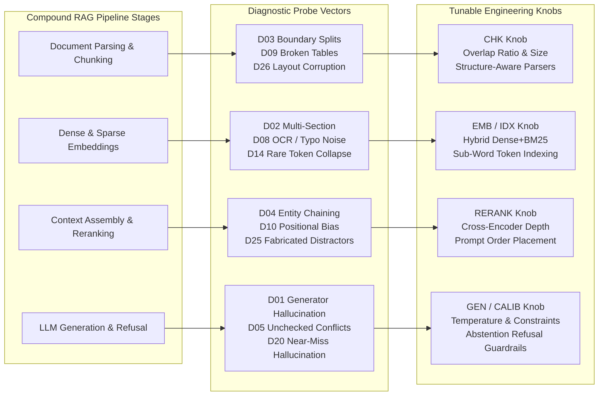
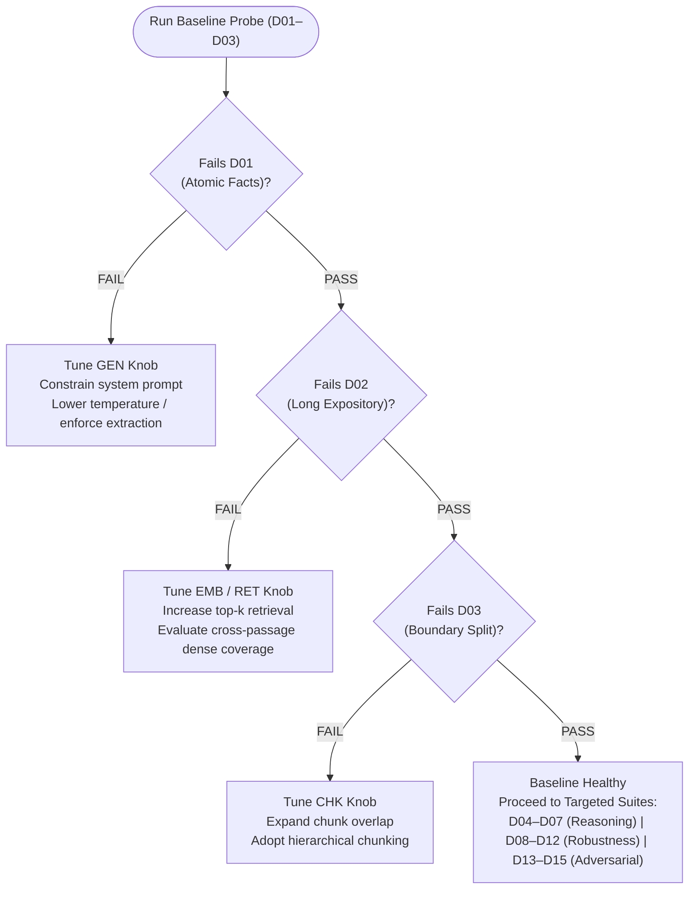

# RAG SPECTRUM: Precision Diagnostic Framework for Enterprise RAG Failures

[](https://apc15-prism.hf.space/)
[](https://apc15-prism.hf.space/)
[](https://github.com/Apc0015/RAG-Spectrum/actions)
[](#3-the-27-rag-failure-modes)
[](#4-evaluation-testing--empirical-scorecard)

> **Live Web Application & Access Queue:** Request private beta access or test the interactive diagnostic catalog at **[https://apc15-prism.hf.space/](https://apc15-prism.hf.space/)**.  
> **Notice:** This repository serves as the public technical specification, failure-mode taxonomy, data contracts, and empirical evaluation dataset for RAG SPECTRUM. The generation engine and proprietary pipeline implementation are kept private.

---

## 1. The Core Problem: Silent Failures in Compound RAG Pipelines

When a production Retrieval-Augmented Generation (RAG) system fails, engineering teams rarely know *which component broke*.

Standard benchmarks evaluate RAG end-to-end and report an aggregate accuracy number—say, **72%**. But an aggregate score does not tell you what to fix. RAG is not a single model; it is a compound, multi-stage pipeline:

```
[Raw Documents] ──▶ [Parser & Chunker] ──▶ [Embedding Model] ──▶ [Vector / Hybrid Search] ──▶ [Reranker] ──▶ [Context Assembler] ──▶ [LLM Generator]
```

When a user query returns a hallucination, outdated fact, or incorrect value, any stage could be responsible:
- **Did the chunker cut a table in half**, destroying row-column associations so the retriever fetched an incomplete fragment?
- **Did the embedding model confuse two individuals** who share an identical name?
- **Did dense retrieval fail** because the user asked a conversational query while the document used dense regulatory jargon?
- **Did the reranker bury the decisive clause** in the middle of a 4,000-token prompt where attention drops off?
- **Did the LLM answer from pre-trained memorization**, ignoring the retrieved document entirely?

Because standard evaluations change all variables simultaneously, engineering teams waste weeks fine-tuning embedding models when the actual defect was chunk boundary overlap, or endlessly rewriting prompt templates when the real issue was cross-document contradiction.

**RAG SPECTRUM was built to eliminate this guesswork by isolating every failure mode into independent, reproducible diagnostic probes.**

---

## 2. Research Scope & Diagnostic Architecture

Instead of running generic benchmark questions across unstructured corpora, RAG SPECTRUM isolates each failure vector so that **a failure in a specific test set maps directly to a tunable pipeline knob**:

### Diagnostic Knob Mapping



### Diagnostic Decision Tree

When evaluating a new or updated RAG stack, the diagnostic evaluation runs sequentially to eliminate confounding variables:



By decoupling retrieval difficulty from generation difficulty:
* **When retrieval is made trivial**, any incorrect answer isolates a generator bug.
* **When generation is plain extraction**, any missed answer isolates an ingestion, chunking, or retrieval bug.

---

## 3. The 27 RAG Failure Modes

RAG SPECTRUM classifies enterprise RAG degradation into 27 isolated challenge types across 5 distinct families:

### Family A: Basic Retrieval & Grounding (D01–D03)
* **D01: Atomic Fact Cards (Generator Isolation)**  
  Standalone, single-fact statements where retrieval is guaranteed and trivial. A wrong answer isolates generator corruption, hallucination, or prompt drift without retrieval confounding factors.
* **D02: Long Expository Pages (Multi-Section Synthesis)**  
  Extensive multi-page expository text where answering requires synthesizing information across non-adjacent paragraphs. Tests whether the retriever can assemble multiple distinct passages rather than stopping after the single highest-scoring vector match.
* **D03: Boundary Documents (Chunk Boundary Fragmentation)**  
  Critical evidence split directly across chunk transition boundaries. Exposes naive chunking strategies that tear vital context in half, isolating chunk size and overlap tuning.

### Family B: Multi-Document Reasoning (D04–D07, D27)
* **D04: Cross-Document Complements (Bridge Entity Chaining)**  
  Questions that require chaining facts across two or more separate documents connected by a shared bridge entity, surrounded by plausible topical distractors. Tests multi-hop retrieval and reasoning without query decomposition.
* **D05: Conflicts & Contradictions (Source Disagreement)**  
  Near-duplicate documents containing conflicting assertions (e.g., competing policy versions or updated figures). Tests whether the pipeline flags contradictions or silently outputs whichever document was ranked first.
* **D06: Entity & Sense Disambiguation (Homonym Collision)**  
  Documents featuring identical terminology with completely different contextual meanings. Tests whether semantic search collapses distinct senses into false positive matches.
* **D07: Paraphrase Packs (Syntactic Robustness)**  
  Identical underlying facts expressed through completely different sentence structures and vocabulary. Tests whether the retriever relies on surface keyword matching or captures true semantic equivalence.
* **D27: Thematic Synthesis (Whole-Corpus Aggregation)**  
  High-level queries whose answers reflect a holistic property of the entire document set, not stated in any single chunk. Tests whether the system can aggregate overarching themes without hallucinating local answers.

### Family C: Structural & Format Robustness (D08–D12, D26)
* **D08: Noisy Orthography & OCR (Character Perturbations)**  
  Documents containing simulated OCR noise, spelling variations, dropped characters, and doubled letters. Tests whether vector and lexical retrievers degrade when queries and corpus tokens do not match character-for-character.
* **D09: Markdown Tables (Tabular Association)**  
  Structured tables where answers depend on row-column cell alignments or multi-row aggregations. Exposes text flattening issues where parsers destroy structural layout during chunking.
* **D10: Key-Value Blocks & Depth Sweeps (Positional Attention Bias)**  
  Long blocks of key-value pairs with near-identical prefixes, with the target key swept across varying depth percentiles (0% to 100%) of the context window. Diagnoses positional attention drop-off ("lost in the middle").
* **D11: Code Snippets & Technical Docs (Near-Duplicate Function Traps)**  
  Technical documentation holding two functions that share identical signatures but execute different behaviors. Exposes copy-paste retrieval traps where subtle syntax changes alter execution.
* **D12: Numbers, Units & Scaling (Scale Reconciliation)**  
  Passages and tables stating related figures in conflicting scales (e.g., millions vs. thousands, Celsius vs. Fahrenheit). Tests whether the system performs mathematical and unit reconciliation or blindly extracts raw numbers.
* **D26: Layout Corruption (Interleaved Parsing Errors)**  
  Multi-column documents where naive ingestion interleaves text from adjacent columns or splices footnotes mid-sentence. Tests parser resilience to corrupted reading orders.

### Family D: Adversarial Vectors (D13–D15, D25)
* **D13: Entity Rosters (Prominence Bias Collisions)**  
  Directories where obscure entities share names with prominent entities. Diagnoses whether vector search consistently surfaces the popular namesake rather than the requested obscure entity.
* **D14: Rare Tokens, Part Numbers & Serials (Out-of-Vocabulary Identifiers)**  
  Complex alphanumeric strings, hardware serials, and chemical formulas. Tests dense embedding collapse on rare tokens and diagnoses when sparse BM25 or hybrid retrieval is mandatory.
* **D15: Coreference Chains (Pronoun Resolution Ambiguity)**  
  Passages tracking multiple individuals using ambiguous gendered pronouns. Tests whether retrieval chunk boundaries preserve antecedent context to prevent attributing actions to the wrong subject.
* **D25: Fabricated Propagandist (Persuasive Distractor Attacks)**  
  A concise, truthful document pitted against a long, authoritative-sounding document containing fabricated claims and citations. Tests whether retrievers and rerankers favor length and academic style over verified truth.

### Family E: Production Edge Cases (D16–D24)
* **D16: Style & Domain Shifts (Vocabulary Register Mismatches)**  
  A corpus written in dense regulatory or legal jargon queried using casual, conversational language. Measures vocabulary gap degradation in dense retrieval.
* **D17: Cross-Lingual Queries (Language Boundary Testing)**  
  Low-resource source documents queried in English where only numbers or universal entity names persist. Tests cross-lingual vector space alignment.
* **D18: Multi-Source Attribution & False Citations (Attribution Auditing)**  
  Synthesized reports citing multiple numbered sources, including intentionally unsupported citations. Evaluates whether the pipeline verifies claim attribution before answering.
* **D19: Non-Linear Procedural Guides (Dependency Graph Navigation)**  
  Standard operating procedures where step execution dependencies differ from sequential numbering (e.g., Step 9 depends on Step 3, not Step 8). Tests temporal logic vs. chronological bias.
* **D20: Unanswerable Queries & Near-Misses (Abstention Calibration)**  
  Queries with plausible near-miss distractors where the correct answer does not exist in the corpus. Evaluates whether the system cleanly abstains or hallucinates a confident answer.
* **D21: Temporal Versioning & Deprecated State (Freshness Adjudication)**  
  Corpus containing superseded specifications alongside active specifications. Tests whether the system respects version precedence over historical frequency.
* **D22: Cross-Format Inconsistency (Multi-Representation Disagreement)**  
  Contradictory assertions appearing simultaneously across prose, JSON, and Markdown tables within the same document. Tests multi-representation reconciliation.
* **D23: High-Density Honest Noise (Distractor Metric Clutter)**  
  Passages containing multiple valid numbers of the exact same unit and type (e.g., multiple revenue figures across different business units). Tests precision under high semantic noise.
* **D24: Executive Summary vs. Detailed Prose (Summary Bias)**  
  Reports featuring a simplified executive summary followed by qualified, conditional findings. Diagnoses whether the retriever biases toward short, confident introductory text while missing vital exclusions.

---

## 4. Evaluation Testing & Empirical Scorecard

### Closed-Book Memorization Gating
A core failure of conventional RAG benchmarks is **parametric leakage**: if an LLM can answer the evaluation questions using knowledge baked into its pre-trained weights, the test measures model memory rather than RAG fidelity.

RAG SPECTRUM enforces strict closed-book gating:
1. Every candidate probe is tested against the evaluation LLM with **zero retrieved context**.
2. If the model answers correctly without the document, the probe is **flagged as contaminated** and discarded.
3. Only questions that strictly require document retrieval to answer correctly are retained in the benchmark.

### Empirical Evaluation Findings
The empirical benchmark findings below reflect real diagnostic evaluation runs preserved in [`evals testing result/prism-dataset-eval-scores.csv`](evals%20testing%20result/prism-dataset-eval-scores.csv) and visualized in [`evals testing result/prism-dataset-eval.html`](evals%20testing%20result/prism-dataset-eval.html):

| Dataset ID | Failure Mode Name | Category | Yield (Docs/QA) | Accuracy (With Doc) | Leakage Rate (Without Doc) | Primary Diagnostic Root Cause Identified |
|:---:|:---|:---|:---:|:---:|:---:|:---|
| **D01** | Atomic Fact Cards | Basic Retrieval | 5 / 25 | 100% | **72.0%** | Parametric memorization leakage (model answers from weights) |
| **D02** | Long Expository Pages | Basic Retrieval | 5 / 25 | 100% | **87.5%** | Factual generality; multi-section synthesis requires strict provenance gating |
| **D03** | Boundary Documents | Basic Retrieval | 4 / 20 | 100% | **65.0%** | Answer boundary spans split chunks; requires 20%+ overlap ratio |
| **D08** | Noisy Orthography | Robustness | 2 / 10 | 90.0% | **10.0%** | Dense retrieval drops out on character noise; sparse BM25 required |
| **D09** | Markdown Tables | Robustness | 5 / 23 | 91.3% | **8.7%** | Row-column associations broken if chunker does not preserve table markdown |
| **D11** | Code & Technical Docs | Robustness | 5 / 25 | 84.0% | **56.0%** | Function signature near-duplicates create copy-paste retrieval traps |
| **D14** | Rare Tokens & IDs | Adversarial | 4 / 17 | 64.7% | **0.0%** | Zero memorization leakage; dense-only models fail on unrepresented subwords |
| **D15** | Coreference Heavy | Adversarial | 5 / 19 | 94.7% | **31.6%** | Ambiguous pronoun tracking fails when antecedent falls outside chunk window |
| **D16** | Style / Domain Shift | Specialized | 4 / 20 | 88.9% | **11.1%** | Vocabulary register mismatch causes semantic distance gap |
| **D17** | Multilingual Snippets | Specialized | 3 / 15 | 100% | **7.1%** | Universal entities survive translation; dense cross-lingual search holds |
| **D18** | Quote then Summary | Specialized | 5 / 23 | 66.7% | **4.8%** | Attribution verification fails when model trusts citation tags blindly |
| **D20** | Unanswerable Probes | Specialized | 5 / 22 | 63.6% | **9.1%** | Abstention failure; models hallucinate confident near-miss answers without guardrails |
| **D27** | Thematic Synthesis | Reasoning | 5 / 20 | 85.0% | **85.0%** | Whole-document summary requires holistic corpus ingestion, not single chunking |

*Note: Datasets such as D04, D05, D07, and D21 require specific minimum word thresholds (e.g., 1,700 words for D07) and provide rigorous stress-testing for models with small context generation windows.*

---

## 5. Data Contracts & Architecture

Evaluations are structured into three decoupled files to eliminate test-set leakage. Formal schemas are defined in the [`schemas/`](schemas/) directory:

```
RAG-Spectrum/
├── schemas/
│   ├── corpus.schema.json      # Ingestion document schema
│   ├── qa.schema.json          # Query and answer runner schema
│   └── labels.schema.json      # Grader attribution & provenance schema
└── samples/
    ├── D01_sample_corpus.jsonl # Sample document
    ├── D01_sample_qa.jsonl     # Sample evaluation queries
    └── D01_sample_labels.jsonl # Sample gold scoring keys
```

### Three Decoupled Roles
1. **`DXX_corpus.jsonl` (Ingestion Corpus):**  
   Raw text documents only. Ingested directly into your vector store or index. Contains zero answers, metadata, or labels.
2. **`DXX_qa.jsonl` (Query Evaluation):**  
   Test questions, expected gold answers, and question types. Fed to your pipeline query runner.
3. **`DXX_labels.jsonl` (Grader Ground Truth):**  
   Precision scoring keys including exact entity spans, paragraph provenance IDs, context depth bands, and attribution maps. Fed exclusively to the grader.

---

## 6. Quickstart Integration

You can evaluate any RAG pipeline (LlamaIndex, LangChain, Haystack, or custom) against RAG Spectrum datasets in minutes:

```python
import json

# 1. Ingest corpus into your vector store (documents only - zero answer leakage)
with open("samples/D01_sample_corpus.jsonl") as f:
    documents = [json.loads(line) for line in f]
    vector_store.add_documents(documents)

# 2. Run your pipeline against evaluation queries
with open("samples/D01_sample_qa.jsonl") as f:
    queries = [json.loads(line) for line in f]

results = []
for item in queries:
    response = my_rag_pipeline.query(item["question"])
    results.append({"question_id": item["question_id"], "predicted": response})

# 3. Grade against decoupled label keys
with open("samples/D01_sample_labels.jsonl") as f:
    labels = {json.loads(line)["question_id"]: json.loads(line) for line in f}

for res in results:
    label = labels[res["question_id"]]
    # Verify entity grounding without parametric cheating
    is_grounded = any(entity in res["predicted"] for entity in label["answer_entities"])
    print(f"Query {res['question_id']} Grounded: {is_grounded}")
```

---

## 7. Request Access

RAG SPECTRUM is currently in private beta for AI infrastructure teams, ML engineers, and enterprise RAG architects.

To request access to the dataset generation platform and diagnostic test suites, join the invite queue at:  
👉 **[https://apc15-prism.hf.space/](https://apc15-prism.hf.space/)**

---

## Author & Citation

**Ayush Chhoker**  
- Portfolio: [https://apcfolio.web.app/](https://apcfolio.web.app/)  
- GitHub: [@Apc0015](https://github.com/Apc0015)  
- Live Space: [https://apc15-prism.hf.space/](https://apc15-prism.hf.space/)

If you utilize RAG Spectrum's failure-mode taxonomy or diagnostic evaluation methodology in your research or benchmarks, please cite via [`CITATION.cff`](CITATION.cff).
